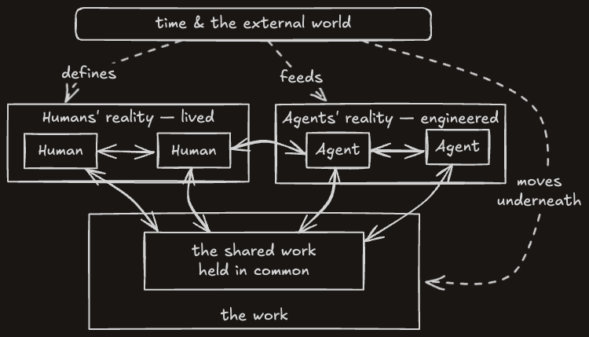
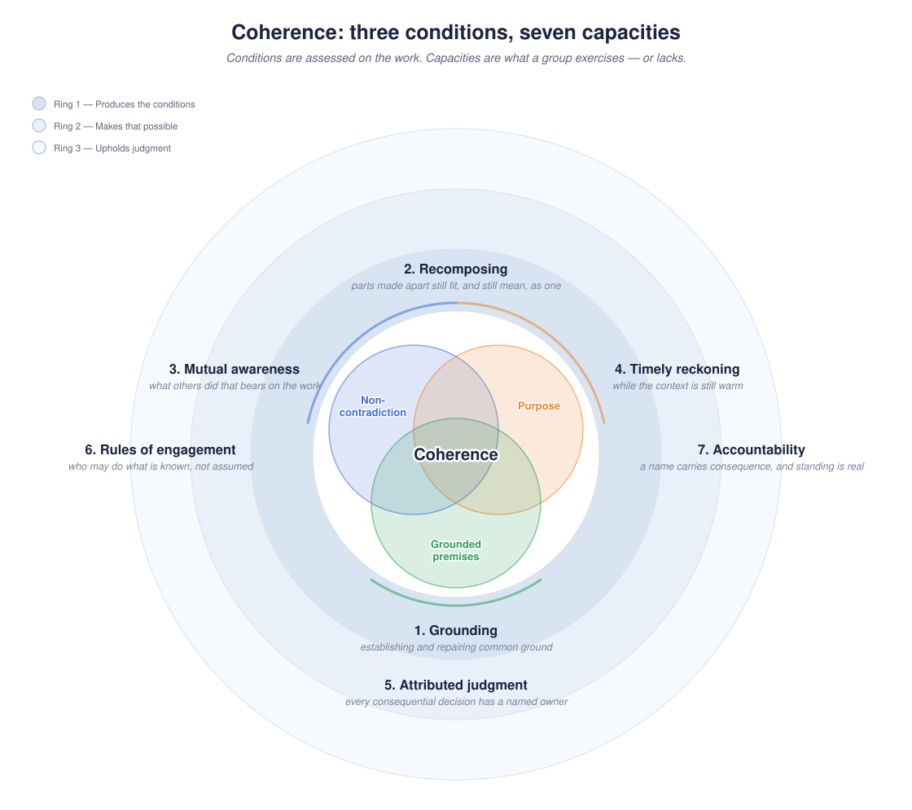
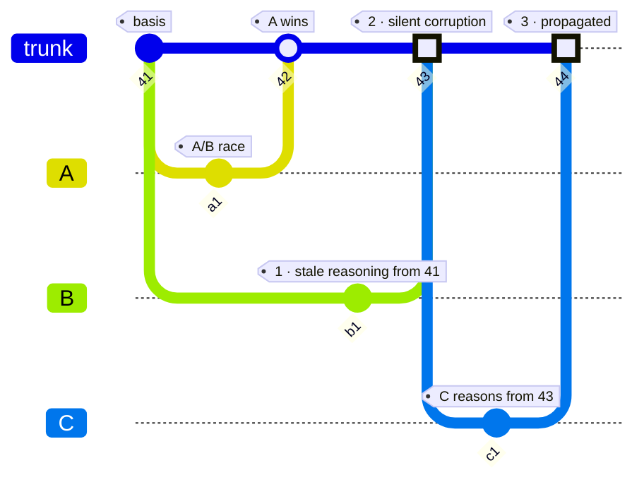

> **Working draft** — comments welcome via [issues](https://github.com/robotfutures/sigma-architecture/issues); please don't cite or quote yet.

# **The Sigma Architecture**

**A substrate for concurrent collaboration with reasoning intelligence**

_Draft — Robot Futures SAS, September 2026_

## **1. A new data flow architecture**

The **Sigma Architectural Pattern** — *Sigma* hereafter — arises from a now ubiquitous problem: we have human and machine reasoning actors working on increasingly unstructured problems. These are humans, agents, and their delegates working in parallel on shared-work products which are semi-structured at best, and against evolving goal posts.

The scope is **virtual collaboration** — participants in separate realities: digital human-to-human(s) and human-to-agent(s). Hereafter, *collaboration* is reference to *virtual collaboration*.

Collaboration requires a reconciled shared context: is my contribution appropriate to the current state? Is a new state consistent with my goals? Are other's changes appropriate and consistent? Shared state requires coordination.

Historically, our efforts in computer science have leaned to coordination machinery, and collaboration as an app on top. Humans as the reasoners acted through these apps which coordinated schema mutations, as with CRDTs, or just improvised like red-lined word documents over email. Sophisticated non-deterministic reasoning rarely entered the picture; the exceptions were the blackboard from classic AI (Erman et al., 1980; Nii, 1986) and game AIs. In both of those cases, collaboration was achieved _through_ synchronized coordination.

That synchronization loop is out of reach while humans and agents are contributing to shared work-products, and world–state is increasingly complicated, along with the criticality of _gated_ contributions and data partitioning for privacy and context management - all happening in parallel and unpredictably. Sigma as an architectural pattern is a response to collaboration's intrinsic pressures.

Sigma aims squarely at the problem of evolving shared-work of semi- and barely-structured sorts, where context is precious, the external world is evolving, inter-actor collaboration is a structured contract, and visibility of information is role-based. The sections below set out what collaboration means here, the criterion success is measured against, and the forces the domain imposes on the response.

What follows is a **pattern** in Alexander's sense (_A Pattern Language_, 1979): forces, and a resolution judged by how it holds them. The claim is that six constraints, held together, resolve the seven forces of the domain (§1.4), and that removing any one collapses a capability the rest depend on (§4, §6.1). Three things lie outside the claim:
- coherence itself, which is assessed by judgment (§1.2);
- novel primitives, since every element has a well-worn precedent and the pattern emerges from composition (§2); and
- measurement, since a pattern yields lessons; we point to the fitness of our implementation to different problems (§6.3).

Sigma is to collaboration what REST is to HTTP: it names the primitives and the discipline for composing them, extracted from where they already work (Fielding, 2000). As with REST, the novelty is in the coupling of familiar parts (§2). The case is made by construction and against prior art.

## **1.1 Collaboration**

Virtual collaboration is:

> Two or more parties working together virtually to create or achieve a goal in overlapping-but-distinct realities, with time and the external world pressuring the work and collaborators themselves.

 
<i>
Figure 1.1: Collaboration, redefined. Each party reasons inside its own reality — the human's lived, the agent's engineered – subject to time and the world.
</i>

Time and the external world are the third party. They steer both and move underneath the work: weather, locations, prices, external systems, and critically, shifting goals. Their part is to write (§3.1).

## **1.2 Coherence**

Coherence here is the linguistic sense — a continuity across the whole (de Beaugrande & Dressler, 1981): the work holds together. Three **conditions** held all at once:

1. **Non-contradiction** — the parts are consistent with one another.
2. **Grounded premises** — the premises each part rests on still hold.
3. **Purpose** — the goals it serves still hold.

Coherence is judged from a view, and views differ — work coherent to its author can be incoherent to a judge who sees otherwise. It is assessed, and thus "by whom" is a first class concern. Sigma cannot deliver coherence itself. As REST is to cacheability (Fielding, 2000) — it does not deliver caching; it provides a deliberate path to it — so Sigma is to coherence.

A second axis to the conditions is what a group must do to keep them true: a condition is assessed on the artifact, a **capacity** is something the group either exercises or lacks. Below are seven essential **capacities**, and the failures their absence produce:

1. **Grounding** — establishing and repairing common ground, so evidence can be told from assertion (Clark & Brennan, 1991). Fails as staleness, and as ungrounded material recirculated until it is accepted as fact.
2. **Recomposing** — parts produced apart assembling into an artifact that still functions, and still means, as one whole. It is continuous: dependencies evolve as the parts do, so two contributions can each be right alone and wrong together (Grinter, 2003). Fails as integration debt, surfacing at assembly (Herbsleb et al., 2001).
3. **Mutual awareness** — each contributor knows what others did that bears on their work (Dourish & Bellotti, 1992). Fails as silent movement.
4. **Timely reckoning** — what moved is dealt with while the context that produced the work is still available. Postponed, the same reckoning is performed at low context, even by its own author, or it lapses.
5. **Attributed judgment** — every consequential decision carries a named owner. Fails as anonymity.
6. **Rules of engagement** — the group's norms about who may do what are known, so work can be coherent with the social structure as well as with the goal. Fails as ad hoc authority, and as disputes about who decides.
7. **Accountability** — a name carries consequence, and standing is real. Fails as role and trust erosion.

The conditions and constraints meet:
- Grounding (capacity 1) produces grounded premises (condition 2).
- Recomposing (capacity 2) is where non-contradiction and purpose are held together at once – which is why requirements drift is a recomposition problem.
- Capacities 3–5 are what make those two possible at all: notice, act while it is still cheap, own the call.
- Capacities 6-7 maintain the social structure that upholds judgment.

 
<i>
Figure 1.2: Coherence and what upholds it. The three conditions are properties of the work and must hold at once, so coherence is their intersection. The rings are capacities — what a group exercises or lacks.
</i>

These are old problems; what is new is holding all seven at machine pace, under the forces of §1.4, with agents who are intrinsically unaccountable, for work-products beyond a compiler's reach.

## **1.3 Trust**

Capacities 6 and 7 are the group's. What changes with agents is what has to carry them. Collaboration is social, and social activity runs on **guardrails**: assurances that protect the shared product and make it rational to participate. Violations have real world consequences.

That was acceptable while contributors were human, because whoever misused the bare layer was accountable in person: reputation, sanction, standing. Agents break it. Highly capable and unaccountable — with no persistent self for a sanction to reach — they contribute at superhuman volume and pace, beyond the reach of socially maintained rules of engagement and accountability alike.

The social structure goes missing too. Conventional software encodes permissions through static access control, which almost always conflates *can I write* with *is my write authoritative*, because humans moderate their own authority according to nuanced standing and context. Taking static permissions to that logical extreme is impractical, because the authority question is highly granular, contextual and fluid. The substrate must therefore support conditional writes, which defer judgment to a party with sufficient standing (§3.8).

Accountability therefore attaches where it still can: to the **principal**, the party a contribution belongs to — usually a person, sometimes a system, in either case something durable enough to be reached by a consequence (§3.1). The rest must be structural — carried by the substrate, through provenance, gates, and traces detailed enough for retroactive accounting (§3.7). This is not the trustless project: judgment is the content of this work (§6.7).

## **1.4 The forces**

The domain has intrinsic pressures against the capabilities which complicate any solution. These pressures are **forces** in Alexander's sense — competing pulls, and a pattern is judged by how it resolves them (1979). Each element of a pattern is present at some force's demand, so a configuration missing one leaves a force in conflict. Validity is therefore functional (§2). The major forces are:

1. **Concurrency, volume, and pace.** Actors reason and act in parallel, and a reasoning act is discrete against a world that moves while it runs. Agentic speed and volume accelerate this inherent drift – and accelerate the domain's failure cascade (§1.4.1).

2. **Variable trust and reliability.** Participants are trusted differently and on an evolving continuum. At one end is an agent with no persistent self (§1.3). At the other a human with full reputation and authority. Between them are ordinary fallibility cases: an agent steered imperfectly, a human missing a critical detail, hallucination by either.

3. **Delegation.** A principal acts through things — apps that do exactly what was clicked, and agents acting on its behalf. The "who" and "how" matters much more now, because intention and execution can be very different.

4. **Partial visibility.** Privacy law and security dictate that no single actor sees everything.

5. **Absence of ambient context.** Humans coordinate through a periphery of informal channels — a corridor, a glance, a history everyone already knows. An agent perceives exactly what a channel serves it. The social structure travels that same periphery, so it goes missing too (§1.3).

6. **Bounded attention.** Information saturation degrades human judgment and model reasoning alike. Context clarity is a scarce resource, spent by everything irrelevant that stays in view.

7. **Quadratic awareness.** $W$ collaborators attending to one another is $W(W-1)/2$ pairwise relationships (Brooks, 1975). Every design inherits it; the question is how to manage it toward linearity.

The forces pull against one another: partial visibility argues for narrow views; mutual awareness argues for wide ones; bounded attention argues for less; grounded premises argue for more; etc. There are many almost-Sigma-shaped solutions in the world today which address or ignore these forces to different degrees. Git and the forges come closest, with gaps (§1.5.2), and bound to code.

Sigma lays out a pattern to competently address all of them.

### **1.4.1 The domain's failure cascade**

Where real-time collaborative editors solved physical line and cursor collisions at human pace, agentic workflows are plagued by a systemic **three-stage failure cascade** (§4.1):

1. **The extended TOCTOU window (temporal gap).** The time-of-check-to-time-of-use question (Bishop & Dilger, 1996), asked at collaboration scale. The classic file-access race is narrow; this window spans **minutes to hours** between an actor reading context (*check*) and submitting work (*use*), and is the ordinary case.
2. **Silent corruption (local failure).** Standard merge mechanisms check for structural or textual line overlap. When an actor works across a wide TOCTOU gap, it produces edits on disjoint lines, syntactically valid and semantically incoherent, and the merge passes in silence. Checking for coherence is left to diligence.
3. **Silent propagation (systemic blast radius).** Once corrupted state lands on an authoritative history, downstream actors ingest it as ground truth, compounding and propagating into other work products (Hochschild et al., 2021; Dixit et al., 2021).

<i>
Figure 1.3: The cascade. Two contributors work from the same state. A lands first; B, still reasoning from 41, lands work on other lines that contradicts A's anyway. C then reasons from the result and carries it further.
</i>

Between two collaborators in a closed world of give-and-take, this is manageable. Above $W=2$ it becomes a paramount concern (§6.4.2), and the cascade is interrupted at one place: the moment of entry, by asking the contribution a different question — whether its premises still hold.

## **1.5 The current art**

Every medium of collaboration in use today answers some of the forces, and each leaves the rest open: work-products other than code, mixed human and machine pace, partial visibility. We examine four media below against the seven capacities.

### **1.5.1 Shared editors and version control**

The **shared editor** — Google Docs, and the OT/CRDT family of algorithms beneath it — addresses mutual awareness and timely reckoning outright: every keystroke is visible in realtime, or in local-first designs, these are algorithmically merged at a later time. The gap: asynchronous awareness stays open, and merging in this fashion misses clean-but-incoherent, even where direct conflict is preserved (§6.4.1).

**Version control** — git and its kin. This addresses grounding exactly: every commit names the state it was made from, durably and by construction. It addresses recomposing through mechanical three-way merge, which surfaces conflict and hands the judgment to a person. It leaves semantic conflict and mutual awareness open by design.

### **1.5.2 The Git ecosystem**

The forge — git + GitHub/GitLab/etc. — supports five of the seven capacities: grounding in the parent, recomposing by three-way merge with a compiler for a referee, attributed judgment at review, rules of engagement in protected branches and code owners, accountability in blame and the fork-propose-maintain ladder. It fails two capacities, mutual awareness and timely reckoning (§1.2), because it keeps no reader state: `git log @{1}..` is local, and timely reckoning has no clock on it. Further, the forge is an application bound to one kind of work-product, where Sigma is a pattern.

On the periphery there are tools that extend git, like [josh](https://github.com/josh-project/josh), which proxies monorepos to respond to the forces of partial visibility and bounded attention.

Git and its ecosystem's acknowledged strengths are why Sigma's vocabulary deliberately resembles theirs. As a pattern, Sigma points to *how to balance the forces of collaboration*, and leaves the domain open.

### **1.5.3 Products for regulated industries**

Where incoherence kills, regulators weigh in and tools to maintain coherence are mandated.

Aerospace and defense run **configuration management** (EIA-649; DO-178C): work is made against a named **baseline**, changes pass a control board, and status accounting keeps the running record of what is approved and what is pending. Requirements management tools add the **suspect link**: change a requirement and every artifact traced to it is flagged; the flag clears when a person re-examines the pair and says so. The obligation to look is created by the change itself and discharged by a named act.

Regulated life sciences use quality systems (ISO 13485; 21 CFR Parts 11 and 820). Records answer to **ALCOA+**: Attributable, Legible, Contemporaneous, Original, and Accurate. Electronic signature binds an act to a person, and the audit trail is immutable and inspected by regulators — attributed judgment and timely reckoning arriving as legal obligation.

These systems exercise all seven capacities, but they fall short of Sigma: they are human-paced by construction (usually Windows apps); an agent at machine pace has no seat – meaning teams in these industries adopting AI must solve this same problem again locally, outside of these tools. Second: they are enterprise products in niche domains; Sigma provides a pattern which can be adapted and adopted widely.

### **1.5.4 New agent-first entrants**

The number of recent entrants working the same forces points to Sigma's relevance.

- Block's **Buzz** (July 2026) unifies chat, forge and agents on one event log. **Addresses** mutual awareness and attributed judgment, against an artifact. **Leaves open** grounding — a log records what happened, and grounding needs what a contributor reasoned from — timely reckoning, and rules of engagement, with approval gates still to come (per author).
- **Cloudflare OS** (August 2026) takes a security-first position: agents start at zero access, resources arrive as typed capability bindings, and opening a gadget is gated on independent entitlement to everything it has read. **Addresses** attributed judgment, rules of engagement and accountability. **Leaves open** mutual awareness (future work, per author) and timely reckoning by design: an action awaiting approval is *simulated* so the agent may continue, and the human approves in bulk, later.
- **Zed's Delta** (2026) records each edit as it happens, at a finer grain than a commit — who made it, and where it falls in the thread's history — and keeps every participant's checkout in sync from that store. **Addresses** mutual awareness and timely reckoning, and attributed judgment finely: work is reviewable and commentable mid-turn. **Leaves open** grounding — a write carries no basis, and the checkout moves underneath an actor while it thinks (§6.4.1).

Each reaches for version control. Buzz integrates a forge. Delta requires the project to be a git repository and leaves commits in git, moving them between machines itself. Cloudflare OS keeps code as real git objects — expressly so that agents may later mount arbitrary repositories with the same tools.
