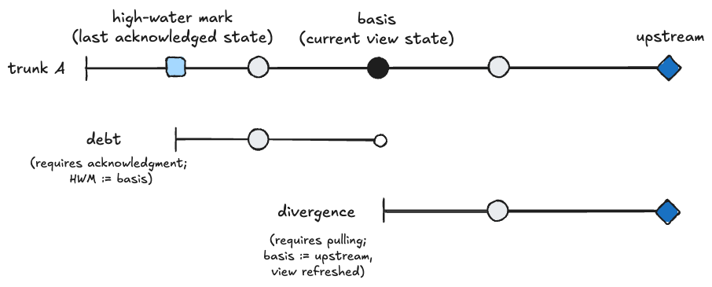
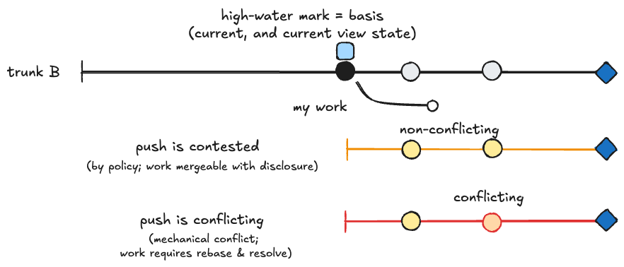
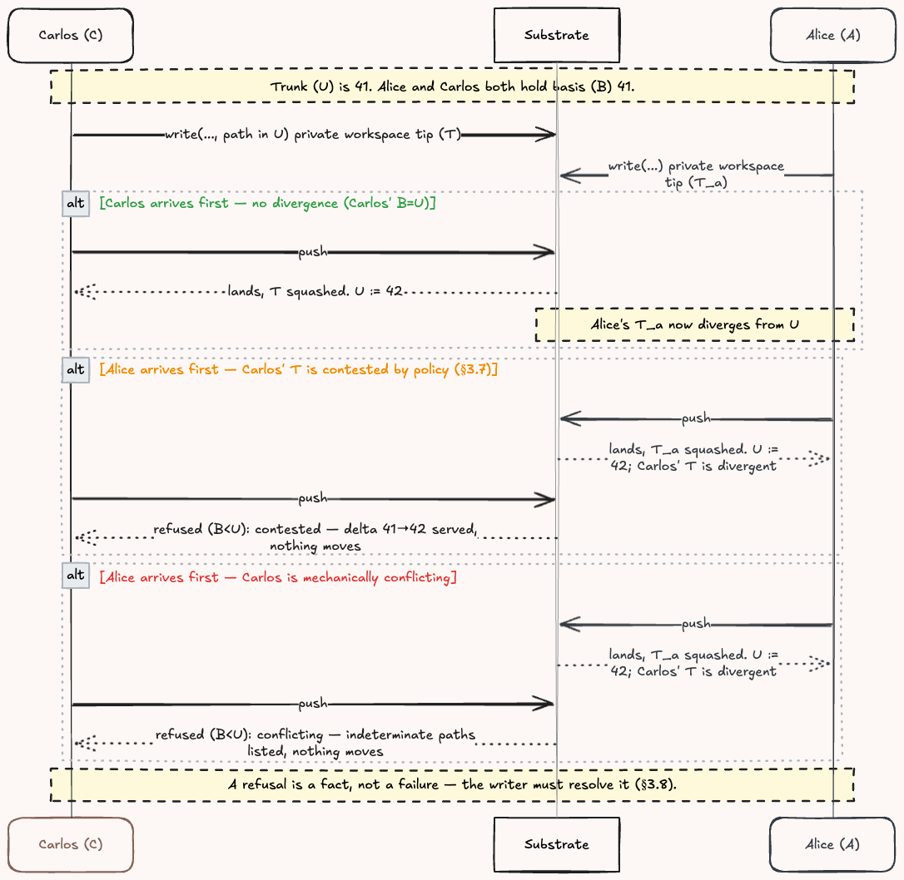
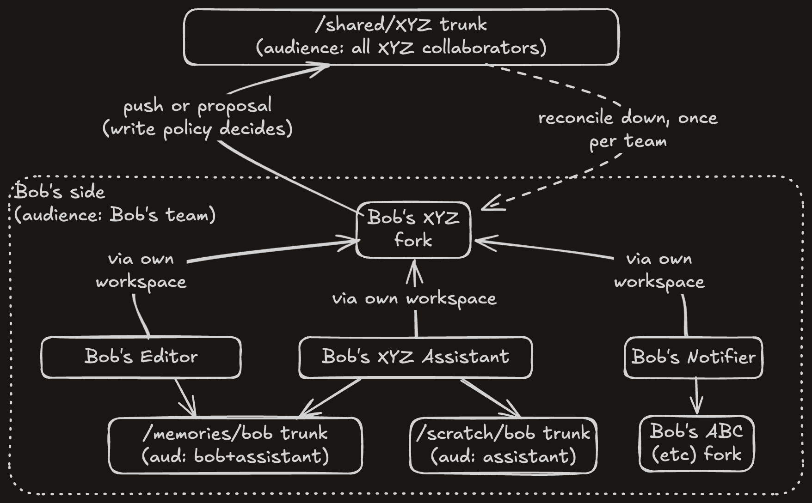
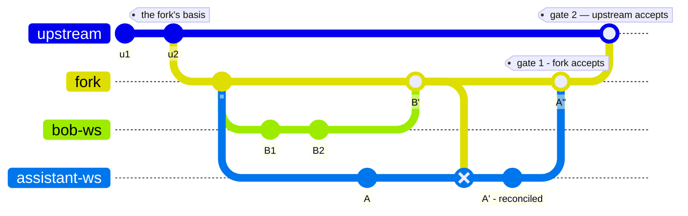

> **Working draft** — comments welcome via [issues](https://github.com/robotfutures/sigma-architecture/issues); please don't cite or quote yet.

## **3. The model**

Definitions, grouped: who collaborates (§3.1), what they touch (§3.2), the pointers that track them (§3.3), the verbs that move the pointers (§3.4), the gate that guards truth (§3.5), the obligations and records it leaves (§3.6–3.7), the shapes it composes into (§3.8), and what a principal has been shown, has seen, and stands behind (§3.9). Each is a statement. The argument for each is §4's.

### **3.1 The cast**

- An **actor** is anything that reads and writes through a workspace — an app, an agent, a notifier, a clock. A **collaborator** is an actor with intent in the work. Every collaborator is an actor; the world is not.
- A **principal** is a responsible party — usually a human, sometimes a deployed system — with **durable answerability**: it can be sanctioned and/or ejected from the collaboration. A principal's perception is assumed effectively continuous across every surface and workspace bound to it, so the substrate holds it once, per principal (§3.9). A principal acts on an application surface, such as a web browser or an HTTP API, or through a **delegate**: a person or an agent acting on the principal's behalf. An act the principal performs on an application surface is its **own**. An act a delegate performs for it is **delegated**. The record names the principal and, where there is one, the delegate (§3.7).
- An **agent** is an autonomous or semi-autonomous AI. It works through a dedicated workspace with data and tools, rather than on an application surface. Its activity in the workspace is recorded as any actor's is: each landing carries the principal it acted for and names the agent as the delegate (§3.7). An agent's unread is its workspace's debt (§3.3), and its perception ends with its workspace. In ordinary use *agent* also names a human delegate; this paper uses it in the autonomous sense, and the difference is left to future work (§7).
- **Shifting reality** — the world and time: weather, prices, locations, external systems, shifting goals. It changes without consultation, and nothing about it is ambient here: an actor perceives exactly what a channel serves it, and every awareness channel is built (§4.5).
- The shifting reality joins the collaboration as a **write-only participant**: a monitor deposits facts as attributed contributions, landing where they are seen and owed (§3.6). Whether facts arrive by monitor or are pulled on demand by a tool in the workspace is a deployment choice.

### **3.2 Objects and interface**

- A **trunk** is $t = (\mathcal{C}, \mathcal{A}, t_{policy})$: one authoritative history $\mathcal{C} = \langle c_0 \dots c_n \rangle$ — an append-only chain of immutable commits, each minted by a landing (§3.5), its head $U = c_n$ — inseparably, one **audience** $\mathcal{A}$ — the answer to "who may see this history?" — and the write policy $t_{policy}$ (§3.3, §3.5), which governs what the trunk admits: its checks, and the **kinds** of object it holds (§3.9.1). Private material stays private by construction: there is no visibility flag to forget, only an audience that was never granted — nothing outside $\mathcal{A}$ can reach $\mathcal{C}$.
- **Membership is a record, not a computation.** $\mathcal{A}$ lives in the trunk's own namespace — principals with roles, path-scoped and inherited. A trunk is created with its first grantor, seeded via the control plane; a workspace opens against membership that already exists. Admission and revocation are writes to $\mathcal{A}$ that append to $\mathcal{C}$ like any landing — attributed commits — and the right to make them is itself a grant: a write mount on the membership slice, bounded by $t_{policy}$ (§3.5, §4.2). $t_{policy}$ is recorded the same way: the kinds it declares (§3.9.1) and the checks it runs (§3.5) are attributed landings on the trunk's own namespace.
- A **kind** $k$ is declared in $t_{policy}$. It names a class of objects the trunk holds, such as a proposal, a task, a procedure or a decision. A kind gives each of its objects an identity and an extent. The identity is a unique **identifier** $\iota$. The extent comes from an **extent rule** $\epsilon_k$, which maps an identifier to a slice of the namespace. An **item** is $i = (t, k, \iota)$, with extent $s_i = \epsilon_k(\iota)$. Two items of one kind have disjoint extents. Extents of different kinds may nest. Every trunk carries the kind *trunk*, with one item whose extent is the whole namespace, so a trunk, a fork and a proposal are items too. An item is the unit a principal attends to, as a trunk is the unit a workspace reconciles against (§3.9).
- The **control plane** is the deployment's live configuration surface: defining trunks and workspaces, seeding membership, audit. It configures the primitives, and is outside any view or workspace — no mount reaches it. It is not a write path into the work: an intervention that touches a trunk's records lands as an attributed commit like any other. **Authentication lives at this boundary**: a workspace is bound to its (principal, agent) when it is opened, and every act inside carries the binding because it arrives through the workspace (§3.7). How a principal proves itself is the deployment's choice; the pattern requires only that the binding hold.
- A **mount** is $m = (t, s, m_{policy})$: a trunk, a slice $s$ of its namespace, and a mount policy $m_{policy}$ — read or write, pinned or unpinned (§3.6), and a grain (§3.3). Read mounts may nest; write mounts are disjoint, so every path has at most one covering write mount and a nest of read mounts above it. Each **mount is a capability** — a grant that both names and authorizes. Authority is reachability; revocation is unmounting; attenuation is composing less. Tools arrive as mounts through the same authority, so operational capability and data access are one grant. The substrate cannot police capabilities a harness grants outside it — that remains a platform-security problem (§4.4, §4.5).
- A **view** is $V = \{ m_1 \dots m_k \}$: a composed, scoped projection of one or more trunks — a mount table assembling exactly the slices this actor, in this role, needs. What the actor can reach is exactly $\bigcup_i s_i$.
- A **view out** $V_B = V @ \vec{B}$ is the materialization of the view at its bases, where $\vec{B}$ holds one basis per mounted trunk — held for a pinned mount, riding $U$ for an unpinned one (§3.6). A view out is a pure read: it mutates nothing and claims nothing (§3.4). When the view is bound directly to a principal, the substrate records which items the view out materialized: a serving, a fact (§3.9.2).
- A **branch** $\beta_t$ is a vector of pointers $(B, H, T)$ per writable trunk $t$ (§3.3).
- A **workspace** is $w = (V, \{\beta_t\}_{t \in V_{rw}})$: a view an actor works in, holding per writable trunk the durable state.
- A **write** mutates branch state — durable, private to the workspace, accumulating toward a commit. A **commit** seals accumulated writes into an immutable unit with a durable identity, author and message: identity equality is history equality, so every $O(1)$ comparison in §3.3 is an identity comparison. **Content addressing** — the identity as a hash of content and parent — supplies it coordination-free (§5.7). The **chain** $D$ is the workspace branch's sequence of commits $\langle d_0 \dots d_n \rangle$ since $B$, its tip $T = d_n$ (§3.3). A chain may be reminted against a new basis $B'$, mutating $T := d_n'$, or dropped, until it lands (§3.4). Landing the chain onto a trunk appends $c_{n+1}$.
- A **fork** is a trunk minted from a commit of another: $t' = (\mathcal{C}', \mathcal{A}', t'_{policy})$ with $\mathcal{C}'$ extending some $c_i \in \mathcal{C}$, holding its own audience and write policy, and retaining a tracking relationship to $t$ (§3.8). $\mathcal{A}' \subseteq \mathcal{A}$ unless $t_{policy}$ grants widening. The kinds are the source's, so an identifier names one item on both sides of the fork.
- A **proposal** is a branch landed onto a new fork's $\mathcal{C}'$: offered for judgment ahead of the landing (§3.5, §5.4). No pointer moves until it is accepted; acceptance lands it as one attributable act.
- The **ledger** $L$ is an append-only record, per $(w, t)$, of every pointer movement and the claim that moved it — an acknowledgment or a landing, with its optional qualifier or disclosure (§3.5). A record is $\langle \text{verb},\ \text{pointer moves},\ \text{note} \rangle$, written $L \overset{+}{\leftarrow} \text{verb}(\dots)$. The pointers are $L$'s current state; audit reads its history (§3.7).
- The **receipt ledger** $R$ is a second append-only record. It is held per $(p, i)$, a principal and an item. It records what the substrate served the principal, what the principal marked seen or done, and what the principal attested, each with the binding that made it (§3.9). It is independent of $L$.
- **The view is the whole interface.** Everything the substrate says to an actor arrives as objects in its view: truth, computed material — summaries, indexes, checks (§5.3) — **tool endpoints** and their metadata, the artifacts of reconciliation: a served delta, a refusal with its grounds, a conflict awaiting resolution (§3.5) — and, for a view bound directly to a principal, that principal's rows in the receipt ledger (§3.9). All of it is governed by the same mounts, permissions, and currency as raw truth. Everything the actor says back is a write in its workspace — the verbs of §3.4 are such writes — so a client's tool surface collapses to two operations (§4.4, §4.5). A delta is a first-class object with a basis. A tool is an object in the view: invoking it is a write to that object, its result a read — one grant, one channel, one record. How objects are laid out is the interface question, deferred to §5.7.
- The substrate is **coordinated for truth, partition-tolerant for work**: a contribution is a transaction against a basis no matter when it arrives, and only the landing needs the coordinator (§4.4).

An agent's working set, a notifier's read-only feed, an app's read-write for UI controllers, and a human's editing view are each a dedicated workspace, $w_a$. The **accessible surface** and the **view out** are different things: policy may entitle a view to more trunks than it composes, the extras excluded for attention rather than security, and included on request.

### **3.3 The algebra**

Every workspace $w$ tracks, for each writable trunk in the view:

1. a basis ($B$) — the trunk state the view came from, which work is computed against;
2. a **high-water mark** ($H$) — the last trunk state this actor has acknowledged seeing in a view out; and
3. a tip of the chain of commits for work in progress ($T$).

The trunk's head ($U$) is not tracked by the workspace.

The pointers live on the **ledger** $L$ (§3.2).

**Invariant:** $H \le B \le U$ and $B \le T$, ancestor-or-equal on the trunk's history. No verb produces a state that violates it. One basis per writable trunk is the default; a workspace holding several checks each independently. Where premises span trunks, a mount may declare its premises $P$ and the basis becomes a vector over the declared set (§3.8.3).

**Conditions** — each a pure function of the pointers:

| condition | predicate | a fact about |
|---|---|---|
| current | $H = B$ | my awareness |
| **debt** | $H < B$ | changes absorbed into my premises, not yet reckoned with |
| **divergence** | $B < U$ | the trunk, upstream of my basis |
| **divergent** work | $B < U \land T > B$ | my work |

Thus, "is my workspace current with my view?" is an $O(1)$ comparison, $B = H$. Debt resembles the "unread" indicator in messaging histories, with two differences. Seeing a rendered view out at $B$ does not discharge it: discharge requires an acknowledgment (§3.4) and optionally a **qualifier** (§3.6). And debt is the workspace's unread, held over a trunk's history. Where a person takes a whole trunk through one synced workspace, as Slack keeps one read position per channel, the workspace's unread is the person's unread. Where several separately read objects share a trunk, a person's unread is held per object in the receipt ledger (§3.9).

How the debt review and discharge experience is handled is a client application's choice: for agents, usually folded into prompts by the harness and discharged at the end of a completed turn; for humans, dependent on the content and application gestures.

 
<i>
Figure 3.1: Debt against divergence, on one trunk. Behind the basis, what was absorbed and not yet examined — discharged by acknowledgment; ahead of it, what moved and is not yet absorbed — discharged by pulling.
</i>

Divergent work ($B < U \land T > B$) falls into three categories — two ruled by the mount's policy, the third by mechanics when the actor tries to land the work on the trunk $t$:

- **Uncontested** ($m_{policy}(T) = \text{ok}$): the divergence is dismissed at the mount's grain, or lies outside the contest domain.
- **Contested** ($m_{policy}(T) = \text{contested}$): the changes are flagged by policy as *possibly conflicting*.
- **Conflicting** ($\Delta(U-B) \perp T$): the changes are mechanically unmergeable.

Independently of divergence, a push may also be refused outright by policy — **non-conforming**, $t_{policy}(T) = \text{denied}$ — a gate on landing, not a category of divergence (§3.5).

**The contest domain.** Only divergence inside the union of the workspace's pinned mount spans may contest. Movement elsewhere on the trunk does not, at any grain. An actor is not held to account for what its view does not show it.

**The grain** is the per-mount **dismissal rule** — which divergence inside the domain stops contesting. Two are normative:

- **tree** (default) — every diverging path the mount covers contests. No dismissal.
- **path** — only paths the branch also wrote. Drift on untouched paths is dismissed.

They are named for the boundaries they use, which are the only two fixable without a parameter. Anything else is an **extension**: declared by the mount, stated together with the merge mechanism that gives it meaning, ordered against nothing. *Hunk* and *line* are extensions, not rungs — where a hunk ends depends on the differ, its context window, and the content — and a line-differ deciding is defensible only where position carries no meaning: append-only logs, inboxes, per-key world state.

**A dismissal is admissible only where both changes coexist without byte destruction.** A write over a delete is destruction. A rule that picks one side's bytes is destruction, so a standing *mine wins* is inadmissible: bytes are picked by resolution (§3.5) or by nobody. Auto-merged is the coexistence case and the only category an extension may reach; a conflicting path trips the gate at every grain.

**Composition.** The narrowest mount covering a diverging path supplies the operative dismissal. Grains are dismissal rules, not grants, and compose accordingly: permissions by union, grains by most-specific-wins. A read mount therefore holds the default in its own region rather than narrowing it, which is what keeps premises outside the write span contesting.

At a dismissing grain, uncontested drift absorbs at the push and arrives as debt rather than as a refusal, and the guarantee degrades from *nothing lands over unseen work* to *nothing lands over contested unseen work*.

 
<i>
Figure 3.2: Contested against conflicting, from a current basis. Contested is policy — the work still merges, and may land with a disclosure (§5.5); conflicting is mechanics — no determinate result until rebase and resolution. No disclosure applies to indeterminacy.
</i>

### **3.4 The verbs**

The workspace supports nine verbs.

1. **ack** — discharges debt ($H < B;\ H := B$) — the only verb that moves the high-water mark;
2. **pull** — absorbs the trunk cleanly iff no work is in flight ($T = B;\ B := U$);
3. **rebase** — absorbs divergence with work in flight ($B < U \land T > B$), reminting the work chain ($B := U;\ T := T'$), deferring conflicts for reconciliation;
4. **resolve** — picks content where a merge is indeterminate during reconciliation;
5. **write** — edits content in the workspace: durable branch state, private to the workspace, accumulating toward a commit;
6. **commit** — seals accumulated edits into a commit on the chain ($T$ advances), each with its author and message;
7. **push** — squashes the chain to a commit $c_T$ and lands it on the trunk ($U := c_T$); the ledger rides a clean landing ($B, H := U'$) — an actor's own landing is never its own debt (§3.7);
8. **abandon** — drops the work in flight chain ($T := B$);
9. **propose** — push's sibling: the same squashed unit, offered rather than landed — chosen deliberately where review should lead, and what a refused push becomes. No pointer moves; the chain acquires an audience (§5.4).

**Read** is the view out (§3.2), kept out of the verb set: it leaves every pointer in $L$ as it is, and $L$ records acknowledgments and landings alone (§3.7). Awareness is claimed by **ack** alone. A view bound directly to a principal **serves** the items it shows, and the receipt ledger records the serving as a fact (§3.9.2).

Three further acts, **mark**, **mute** and **attest**, belong to a principal rather than to a workspace (§3.9.3): they write $R$.

The chain (§3.2) is a unit: a push lands it squashed as one attributable act, and a rebase remints it — commit for commit, author and message preserved — so a catch-up never collapses the items.

### **3.5 The gate: acceptance, refusal, reconciliation**

**Accepted.** A push lands in exactly two ways:

1. **Clean** — current, conforming, and uncontested: debt acknowledged ($H = B$) and no contested divergence at the mount's grain (§3.3). At the default tree grain this is $H = B$ with no divergence in the contest domain — $H = B = U$ for a workspace mounting the whole trunk, weaker for one that does not; under a dismissing grain, uncontested drift absorbs at the push and arrives as debt. The landing mints a commit on the trunk, $U'$, and the ledger rides: $L \overset{+}{\leftarrow} \text{push}(c_T;\ B, H := U')$ — an actor's own landing is never its own debt (§3.7).
2. **Disclosed** — the push may carry a **disclosure** (defined below) accepting its contested divergence. The work lands loudly: $L \overset{+}{\leftarrow} \text{push}(c_T, \text{disclosure};\ B := U')$ — the absorbed span arrives as debt.

**Refused.** Four grounds, each with its own discharge:

1. **Open debt** ($H < B$) — the change may rest on premises never reckoned with. Discharged by **ack**.
2. **Non-conformance** ($t_{policy}(T) = \text{denied}$) — the push violates the trunk's write policy (§3.3): a path outside the grant, standing short of push, a required check unmet. No disclosure satisfies it. Discharged by rework to conformance, by **propose** where standing demands review, or by **abandon**.
3. **Contested divergence** ($B < U;\ m_{policy}(T) = \text{contested}$) – the change is flagged by the mount's grain, inside the contest domain. Discharged by rework, or stepped over by a **disclosure** — a writer-supplied, structured note acknowledging the divergence, attached to the act and riding the landing onto the books.
4. **Conflicting divergence** ($B < U;\ \Delta(U-B) \perp T$) — refused regardless of any disclosure. Discharged only by **resolve** — the indeterminate paths are served as objects in the view, each carrying both sides and the basis, and the resolution is written back in the workspace.

**Checks are hooks.** The "required check" of ground 2 is a **hook**: a check recorded in the trunk's own namespace as part of $t_{policy}$, like $\mathcal{A}$ (§3.2), under a **class** naming what it governs — the trunk itself, a companion, or a kind (§3.9.1). A hook runs at commit, as early feedback that leaves the tip open, and at landing, as the guarantee. It is read from the recorded head, so the check that judges a push is fixed before the push arrives, and who may change a hook is who may write the trunk's records. It sees the candidate tree, the paths the writer changed, and the principal, so the same content gets the same answer from every writer. A refusal is non-conformance naming the class and the hook's own token, and a hook that fails to answer refuses. Forks inherit hooks by stacking: a landing on a fork runs the source's hook for the class and then each level's down to its own, and any refusal refuses (§3.8).

Nothing moves under a refusal, and the basis-to-now delta is served with it. The refusal is recorded as a fact, not a transient failure — $L \overset{+}{\leftarrow} \text{refuse}(\text{ground},\ \Delta(U{-}B))$ — it leaves the writer an obligation in that workspace. The four grounds differ in kind: open debt and a conflict are **facts**; non-conformance is a **prohibition**; contested is a **warning**. The rule follows from these kinds — a disclosure discharges exactly one refusal, the warning: it converts policy's flag into an accepted risk, loud, on the books. It cannot lift a prohibition, produce a merge, or stand in for an acknowledgment.

**The dials.** Two, set by the deployment: the **grain** (§3.3), which decides the granularity that contests; and the **gate position** (§5.4), which decides whether judgment sits ahead of the landing — a proposal — or after it, as every affected reader's debt.

**Reconciling refusals**

The table below summarizes the mechanics of reconciliation, based on the state and the actor's ruling.

| state | the ruling | the response | on the books |
|---|---|---|---|
| Open debt | N/A | ack(qualifier?) | $L \overset{+}{\leftarrow} \text{ack}(H := B,\ \text{qualifier?})$ |
| Contested | No conflict: the delta does not touch my premises | push, with a disclosure accepting $B \to U$ | $L \overset{+}{\leftarrow} \text{push}(c_T, \text{disclosure};\ B := U')$ — the span stays open as debt |
| | Overrule: cannot reckon now but work should land anyway | rebase; push with a disclosure | $L \overset{+}{\leftarrow} \text{push}(c_{T'}, \text{disclosure};\ B, H := U')$ — loud, on the record |
| Conflicting | Fix & land: conflicts can be clearly resolved | resolve each; rebase; ack; push | $L \overset{+}{\leftarrow} \text{push}(c_{T'}, \text{resolution};\ B, H := U')$ — attributed |
| | Fix & defer: conflicts are resolvable; needs other eyes | resolve each; rebase; ack; propose | $L \overset{+}{\leftarrow} \text{propose}(c_{T'}, \text{resolution})$ — a new fork |
| Any | Defer: judgment belongs to others | propose | $L \overset{+}{\leftarrow} \text{propose}(c_T)$ — no pointer moves (§5.4) |
| Any | Rework: the refusal details mandate re-reasoning | rebase; re-reason $T' \to T''$; ack; push | $L \overset{+}{\leftarrow} \text{push}(c_{T''};\ B, H := U')$ — clean, from the new basis |
| Any | Superseded: my work no longer applies | abandon | $L \overset{+}{\leftarrow} \text{abandon}(T := B)$ — nothing landed |

We now walk the gate end to end. Alice and Carlos — one may be human, one an agent; the model does not distinguish them — share a working trunk at head 41, and both hold basis 41. They edit the same trunk, possibly the same file, and while Carlos works, the trunk moves.

 
<i>
Figure 3.3: Concurrent editors.
</i>

The substrate blocks the TOCTOU race and CAS forces ordering; the late party reconciles a contested or conflicting change. This is the ordinary case: Carlos was doing a job, then the world moved. Doing the job *diligently* means reckoning with the movement before contributing. The substrate does not make Carlos diligent — it makes the reckoning an obligation and keeps the record.

### **3.6 Obligation to the books**

Debt requires an acknowledgment on the ledger; no ledger can force a reader to think, but the acknowledgment establishes a logged claim. When a change lands with known divergence, that claim is logged the same way.

This obligation needs dials. It is not always possible to attest full knowledge and full understanding, and work must continue — so a qualified statement, a **qualifier**, is legal and recorded: "I am acknowledging this, but I do not fully grok it, so my inbound changes are also qualified." These statements (recorded with an ack or push) have two uses: a recorded claim for retrospective audit, or evidence for a policy that blocks a submission and lands it as a proposal instead.

The **obligation is a property of the mount, not of the change.** $m_{policy}$ (§3.2) tunes the ledger on two dials: **pinned** (default) vs. **unpinned**, and the grain (§3.3). Unpinned suits mounts that are read-only and ambient — acknowledging their debt would be noise, and the basis moves freely with the view out (a continuous, implicit pull).

An actor is **write-only** when it is the sole writer of its mounts' spans: any divergence it meets lies outside its contest domain (§3.3), so it never contests, and its own landings are never its own debt (§3.7). It contributes, and it owes nobody a look. This is a property of the topology, not a dial. That is what lets externalities take a seat (§3.1) — a monitor deposits a price, a forecast; its landings raise debt for whoever mounted that trunk *pinned*; it acknowledges nothing in return because it observes nothing in the substrate's world. Full participant on the write path, absent from the read path — an unequal peer, legible in the books. At the opposite setting, an actor whose every mount is *pinned* never meets a change it has not consciously taken on — expensive, and appropriate for content where drift is intolerable.

The obligation in this section is the workspace's, and an acknowledgment discharges it at the grain of a trunk delta. The record of what a principal has seen or stands behind is kept per principal (§3.9). A person who read a change on one surface and then pushes from a workspace that absorbed the same change still owes that workspace's acknowledgment: the work there was computed against the old state, whatever the person knows.

### **3.7 The record**

Sigma records, on every change: the **principal** — who the work belongs to and answers for it; the **delegate** — the person or agent that acted on the principal's behalf (§3.1), when the act was delegated; the **workspace** it came through; and the **basis** the write declared (§3.3). The four together are **basis provenance**: what state the work was produced against, and on whose authority.

- The guarantee is at the grain of the landing — the grain at which the change was judged (§3.5). Anything finer is retrievable, not contracted: the landing keeps the chain it was made from as a second parent — a **provenance edge**, not a merge — so pre-landing work stays reachable, and acceptance is derivable from ancestry rather than asserted.
- A VCS *can* store this information; Sigma makes it obligatory. A commit arrives through a workspace to a trunk, and the agent is authenticated through the workspace (§4.3).
- The record is consumed by the model's own machinery: enforced permissions (§3.2); the reconciliation of inbound change — who am I colliding with, human or delegate? (§3.5); the calculation of debt — if only your changes are new, you are not out of date (§3.3); and the calculation of receipt — a landing a delegate made is news to its principal (§3.9).
- An entry in the receipt ledger carries the same binding (§3.9.3). By default it is accepted only from the principal itself. Where a deployment admits a delegated mark or attestation under a grant the principal issued, the entry records the grant and the delegate, and reads as delegated.

**Provenance is not endorsement.** Knowing who made a change tells nothing about whether anyone else has accepted it (§3.8, §5.4).

### **3.8 Topology**

#### **3.8.1 Structure**

Sigma assumes one or more trunks, composed into a workspace, with read-only or read-write permissions (§3.2). Every writable trunk in a workspace acquires a workspace-local branch, and its own basis, on its first write (§3.3).

The **fork** (§3.2) extends the same machinery one level. The containment $\mathcal{A}' \subseteq \mathcal{A}$ is what keeps fork-and-share from routing around the boundary, and membership being a record is what makes it checkable. Movement of $U$ is the fork's debt; its chain goes upstream as any chain does — pushed, or proposed (§3.8.2, §5.4). Two differences from a source forge: tracking is an obligation on the books — a fork cannot silently fall three hundred commits behind, because the gap is debt — and forking is the ordinary process, not an exceptional act.

Concretely: Bob is a participant in a shared project. Bob gets a fork of the plan trunk; its audience is Bob's side of the table — Bob, Bob's agents, Bob's notifiers. His assistant branches off *his fork*, not off the shared trunk. Everything in flight on Bob's side is invisible upstream by construction: privacy is the audience boundary itself, not a visibility flag.

 
<i>
Figure 3.4: Hierarchical topology. Bob's fork, his workspace, and his assistant's, each branching from the fork rather than from the shared trunk.
</i>

#### **3.8.2 Mechanics**

Work crosses a trust boundary by landing again — with its own basis and its own gate — never by being replicated across it. Write $t$ for the shared trunk with head $U$, and $t'$ for the fork with head $U'$. The fork stands toward $t$ as a workspace stands toward its trunk: it holds $(B, H)$ against $t$, and movement of $U$ is its debt (§3.3).

- **Downstream — the pull.** When $U$ moves, the fork's side reconciles once: the span $\Delta(U - B)$ lands on $t'$ as one attributable act, minting $U'$. The $M$ workspaces on the fork's side then catch up against $U'$ locally — one reconciliation at the boundary, $M$ cheap ones below, none of them touching $t$.
- **Upstream — the push, or the proposal.** The fork's chain goes to $t$ as any chain does (§3.4): **push** where $t_{policy}$ grants standing, **propose** where it does not (§5.4). Same work, same gesture — $t_{policy}$ decides how it lands.

**Trust is a write policy.** An unverified party gets the same fork and works normally — everything attributed, everything private to its side — with proposal-only rights upstream. Its work accumulates as a standing proposal, and verification opens the gate the work was waiting at. There is nothing to stash or replay, and no second-class mode.

The relation nests: a fork of a fork aggregates its own side's work and reconciles once at each boundary, so a large collaboration integrates in tiers instead of contending on one trunk. Keeping $W$ small becomes an operation on the topology rather than a reorg (§6.4.2).

<i>
Figure 3.5: Working on forks. The upstream never sees the interstitial commits, never holds an actor's half-finished reasoning, and answers to exactly one contributor — the fork owner itself. That is what "every hop a gate" buys, and it is the same push machinery.
</i>

When a fork's work is stale against its upstream ($B < U$), the reconciliation lies with the fork's side — the obligation is a property of the mount, and the fork is what tracks (§3.6). Who may discharge it is read from $\mathcal{A}'$, never wider than $\mathcal{A}$ allows. The rework lands as one attributable act with the chain riding as its provenance edge (§3.7). Each landing then leaves every workspace below with $B < U'$, and the same rule applies one hop down: debt travels one boundary at a time, and no hop reaches past its neighbor — the topology's cost stays linear (§6.4.2).

#### **3.8.3 Premises spanning trunks**

The topology above runs vertically. Sibling trunks in one workspace are the horizontal case, and by default they are unrelated — each carries its own basis (§3.3), so a push checks one basis against one trunk and says nothing about the others.

A mount may declare its premises $P \subseteq V$, and the basis becomes a vector $\vec{B} = (B_t)_{t \in P}$ — taken from one consistent read, checked as one predicate at the gate, landed in one transaction.

This is a variation point, and it requires atomic commit across the declared refs and a consistent read to take the vector from; trunks declared together share a transaction domain. The deployment sets this, never the actor — an actor declaring its own premises is self-reporting (constraint 2). Independence stays the default because coupling costs: contention returns along the declared edges (§6.4.2). DOORS reaches the same conclusion in its **baseline set**: pin the whole relationship or pin nothing (Aragon et al., 2014).

### **3.9 Receipt**

§3.3 to §3.7 account for a workspace: what it absorbed, acknowledged and landed. This section accounts for a person. Debt answers "has this workspace reckoned with what moved under its work?", and it is the right question for an agent, whose perception begins and ends with its workspace (§3.1). A principal perceives across every surface and workspace bound to it, over days, and the questions it asks are different: *what is new to me*, *what have I seen*, *what have I put my name to, and is that still the current version*. Those questions are asked per object and answered per person. This section defines the object, the item, and the record, the receipt ledger. A receipt records that something reached a party. Here it records what was shown to a principal, what the principal marked seen or set aside, and what the principal attested, each separately.

#### **3.9.1 Items**

An item $i = (t, k, \iota)$ is an identified object of kind $k$ on trunk $t$, with extent $s_i$ (§3.2). Its **state** at a commit is the content address of its extent there, $\sigma_i(c)$. Its **history** is the subsequence of $\mathcal{C}$ at which that address changed, $\mathcal{C}_i = \langle c \in \mathcal{C} : \sigma_i(c) \neq \sigma_i(c^-) \rangle$, and its **head** $U_i$ is the last commit of $\mathcal{C}_i$. A landing changes every item whose extent covers a path it touched, so one commit may advance many item heads, and a change outside every declared extent advances the trunk item alone. A trunk's policy says whether the trunk item has rows in the receipt ledger (§3.9.2). A channel that people follow as one thing needs them, because the channel is the item they follow.

A kind's declaration states the rules its items must meet: a **schema** for the content, the **transitions** the item's state field may make, and which paths within the extent are **write-once**. The gate checks every item a candidate touches against its kind, at commit and at landing, and a failed check is non-conformance on ground 2 (§3.5). The declaration is data, so a client can read the rules before it writes. Rules beyond the declaration, such as who may write which field, are **hooks** (§3.5) under the kind's class, and they run after the declared checks. A fork inherits both with the kind. Which kinds a trunk declares, and with what rules, is policy, set by the deployment.

Items keep one landing across many objects. A proposal accepted onto a trunk lands as one commit (§5.4) however many items it touches; the workspaces that track the trunk owe one commit (§3.3), and every principal with a row on a touched item sees that item move (§3.9.2). The alternative, one trunk per object, buys per-object currency at the cost of one landing per object.

#### **3.9.2 The receipt ledger**

For a principal $p$ and an item $i$, the receipt ledger $R$ holds:

1. **served** ($E_{p,i}$) — the latest state of $i$ that was shown to $p$ on an application surface. The substrate writes it at the view out of a view bound directly to $p$ (§3.2). It is a fact, recorded at the grain and cadence the deployment chooses;
2. **seen** ($S_{p,i}$) — the latest state of $i$ that $p$ has marked seen. It is a claim, and only $p$'s own act moves it;
3. **done** ($D_{p,i}$) — the state of $i$ at which $p$ set the item aside. It is a second position, independent of seen; and
4. **attestations** ($Q_{p,i}$) — a set of $(\sigma, \mu, \epsilon, \tau)$. Each is a claim on one state $\sigma$ of $i$, with a **meaning** $\mu$ from a closed set the deployment declares, the **evidence** $\epsilon$ the deployment requires for that meaning, and the time $\tau$. An attestation carries a name and stays on the ledger.

Seen and done answer different questions. Seen answers "have I taken in this version?", which is perception. Done answers "does this version still need me?", which is attention. Seen without done is the common case: a principal reads a review request and still owes the review, so the item stays in front of it. Done without seen is triage: a principal clears an item without opening it. If done implied seen, clearing an unopened item would record a perception that never happened. Both positions are compared with the item's head, so a new change reopens both. Mute (§3.9.3) is a third scope, attention over all future changes of the item, which is why it changes exposure rather than being a position.

Each of $E_{p,i}$, $S_{p,i}$ and $D_{p,i}$ is a position in $\mathcal{C}_i$, or $\varnothing$, no position, which is below every commit. Each attestation's $\sigma$ is a state $i$ has held. The ledger is indexed by $(p, i)$. The items on which $p$ holds a row are its **exposure**, $\mathrm{dom}(R_p)$. A row opens in three ways: by serving, by $p$'s own mark, or by an **address**. An address is a landing whose kind names the principals it is for, such as a review request, a mention or a distribution list; it opens a row at $S = \varnothing$ for each principal named. A row closes by **mute**: the item leaves the principal's exposure, with a reason, until the principal takes it back (§3.9.3). A row carries the acts that opened, moved and closed it. Those acts are the reason an item is in front of the principal.

**Conditions**, each a pure function of one row:

| condition | predicate | a fact about |
|---|---|---|
| **unread** | $S_{p,i} < U_i$ | what is new to me |
| **done** | $D_{p,i} = U_i$ | what I set aside at its current version |
| **unserved** | $E_{p,i} < U_i$ | what moved since I was last shown it |
| **attested** | $\exists\, q \in Q_{p,i}:\ \sigma_q = \sigma_i(U_i)$, in force, by meaning | what I stand behind, on the current version |
| **stale** | $q \in Q_{p,i}$ with $\sigma_q \neq \sigma_i(U_i)$ | a claim on a version that has moved |

Each condition is one comparison, so "is anything new to me?" costs $O(|\mathrm{dom}(R_p)|)$, which is dimensioned by what the principal attends to (§4.6). An item is in front of the principal while $D_{p,i} < U_i$. It is unread while $S_{p,i} < U_i$. An inbox therefore shows the rows with $D_{p,i} < U_i$ and counts the rows with $S_{p,i} < U_i$, and an item set aside returns when it moves.

An unread item that is also unserved moved on a surface other than the principal's. An unread item that was served is shown and awaits a mark. The deployment may refuse a mark on a state the principal has yet to be served (§3.9.4).

An attestation is current while the item's state is the one it names. When the item moves, every attestation on the old state is stale. Content addressing makes this exact: an item restored byte for byte to an attested state is attested again.

Debt and receipt are held apart by construction:

| | debt (§3.3) | receipt |
|---|---|---|
| held per | workspace and trunk, $(w, t)$ | principal and item, $(p, i)$ |
| a fact about | the premises of work in one workspace | what one principal was shown, has seen, and stands behind |
| shape | a frontier on the trunk's history, over the tracked spans | two positions on each item's history, seen and done, and a set of attestations on its states |
| opened by | absorbing another actor's landing: pull, rebase, push | serving, the principal's own mark, or an address; closed by mute |
| discharged by | ack, with an optional qualifier | mark, to seen or to done; attest, with a meaning |
| self | the workspace: its own landings ride $H$ (§3.4) | the principal itself: a delegated landing is news to its principal |
| moved by a delegate | yes — an agent is its workspace | refused by default; accepted under a scoped grant from the principal and recorded as delegated |
| consequence | refuses the workspace's next push on that trunk | a write policy may read it (§3.5, ground 2) |
| cost to query | $O(1)$ per trunk | $O(1)$ per item |

An item's state is **delivered** to a workspace when the workspace's basis is at or past the commit that made it, $U_i \le B$. The pointers of §3.3 already hold this fact. What is delivered and awaits acknowledgment is debt. An item's state is **served** to a principal when it is shown on an application surface, and the receipt ledger records it as $E_{p,i}$. Delivery and serving are independent of each other.

The two ledgers and their verbs are fully independent: the verbs of §3.4 write $L$ only, and the acts of §3.9.3 write $R$ only. The same landing may be debt in three of a principal's workspaces and one unread item in $R$, and acknowledging it in all three leaves the item unread. The two ledgers agree when a person takes a whole trunk through one synced workspace, as a channel is read: the trunk item is then the only item, so its row and the workspace's debt move together. Where separately read items share a trunk, as items in a space or threads in a room do, they differ, which is why Matrix moved from one read receipt per room to one per thread.

#### **3.9.3 The acts**

Four acts write $R$. The substrate writes serve, and the principal writes mark, attest and mute. Support for the receipt ledger is optional: a substrate may implement $R$ and its acts in full, in part, or leave them out.

1. **serve** — the substrate writes it when a view bound directly to $p$ materializes a state of $i$: $R \overset{+}{\leftarrow} \text{serve}(E_{p,i} := c)$. A view out to a delegate is fully independent of its principal.
2. **mark** — $p$ sets $S_{p,i}$ or $D_{p,i}$ to any state in $\mathcal{C}_i \cup \{\varnothing\}$, forward or back: $R \overset{+}{\leftarrow} \text{mark}(S_{p,i} := c)$ or $\text{mark}(D_{p,i} := c)$. Setting $D_{p,i}$ to $U_i$ sets the item aside until it moves. Setting $S_{p,i}$ back to an earlier state is "mark unread". Both append to the record. A snooze is a done with a time to return, and a star is a label; both stand apart from the item's history, so both belong to the application or to an extension.
3. **attest** — $p$ adds $(\sigma, \mu, \epsilon, \tau)$ to $Q_{p,i}$: $R \overset{+}{\leftarrow} \text{attest}(\sigma, \mu, \epsilon)$. A later attestation with the meaning *rescinded* names an earlier one and ends its effect, and both stay on the books.
4. **mute** — $p$ closes its row on $i$ with a reason: $R \overset{+}{\leftarrow} \text{mute}(i, \text{reason})$. The item leaves the principal's exposure until the principal's own mark reopens it. Whether a serving or an address also reopens it is the deployment's choice. A mute changes exposure.

**Perception stays with the principal by default.** A mark, a mute or an attestation is accepted from the principal itself. The same act from a delegate is accepted only under a **grant** from the principal: a scoped, recorded authorization, in the way a signed mandate authorizes an agent to act for a person in payments (Google, 2026). The grant is a variation point. An entry made under a grant carries the grant and the delegate, and it reads as delegated. An attestation whose evidence rule requires the principal's own authentication at the act stays with the principal under every grant. A principal's own landing on $i$ rides $S_{p,i}$ and $E_{p,i}$ over the new state when $S_{p,i} = U_i$ beforehand, as a landing rides $H$ (§3.4, item 7). A delegated landing leaves $S_{p,i}$ where it is, so a delegate's result is news to its principal. An attestation may be pressed by the person, or issued by the application when the person completes something; the deployment's evidence rule for the meaning says which it accepts, such as a fresh authentication at the act for a Part 11 signature (§4.3), or a click for a hold notice.

#### **3.9.4 What policy may read**

A hook may read the receipt ledger at the landing (§3.5), and that is the one way it reaches the gate. Two sentences of that form: a landing that cites item $i$ at state $\sigma$ requires the landing principal's current attestation on $i$ with meaning $\mu$; acceptance of a proposal requires $n$ current attestations with meaning *approved* from principals holding role $r$ at the proposed paths (§5.4). For this the gate hands the hook the rows that bear on the landing, as of the landing: the landing principal's attestations on the items the candidate touches or names, and at an acceptance the attestations on the proposal item. One rule belongs to the ledger itself: a deployment may accept a mark on $i$ only where $E_{p,i}$ is at or past the marked state, so that a principal claims to have seen only what it was shown. A person's write from a workspace with open debt is, by default, discharged by that workspace's acknowledgment, qualified where the person posts before reading (§3.6). A trunk's policy may instead require that the landing principal has been served or has marked the current state of the item it writes. The ledger is readable by its principal, by write policy, and by whoever the deployment's audit role admits. Whether a served party can see the record of its own serving is the deployment's choice.

Two cases, in the model's terms.

*A principal returns after three days.* Its exposure holds forty items; seven have $S_{p,i} < U_i$. One is a result a delegate landed for this principal, which is news to it because the landing was delegated. One is a proposal another principal's delegate opened, addressed to this principal for review, so its row opened at $S = \varnothing$ by the address. Opening an item on the application surface serves it and, by the application's choice, marks it, in one write. A proposal accepted over the weekend landed one commit on the trunk touching twelve items: the agent tracking the trunk owes one commit in its workspace, and the principal sees twelve rows, each carrying the acceptance as the act that moved it. Posting a reply from the app lands through a workspace whose write mount is the item's extent; that workspace's debt is exactly the item's own movement since the view out, discharged at the write with a qualified acknowledgment if the person posts before reading it (§3.6).

*A controlled procedure moves from $\sigma_1$ to $\sigma_2$.* The executions trunk's policy requires, of a landing that cites the procedure, the landing principal's current attestation on it with meaning *trained*. Every operator's attestation on $\sigma_1$ is now stale, and a landing citing $\sigma_2$ by any of them is non-conforming until a new one exists. Reading the revision in the training application serves it. Completing the application's check issues the attestation, or the operator presses the control that does, and the application supplies the evidence the deployment requires for the meaning. The ledger holds the binding, the state, the meaning, the evidence and the time. An attestation from a delegate acting for the operator is refused. An auditor reads one row: served at $\tau_1$, marked seen at $\tau_2$, attested *trained* on $\sigma_2$ at $\tau_3$, and whether $\sigma_2$ is still the procedure's state. A controlled-copy acknowledgment, a hold notice, a review approval and an electronic signature are this same shape, differing only in meaning and evidence.
