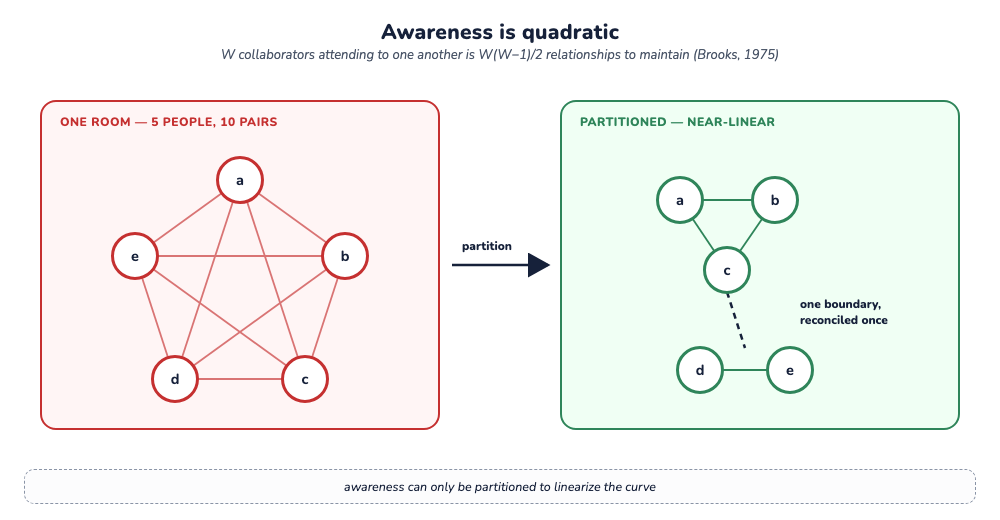

> **Working draft** — comments welcome via [issues](https://github.com/robotfutures/sigma-architecture/issues); please don't cite or quote yet.

## **6. Analysis**

## **6.1 The removal test**

§1 states the claim; §3 the model; §4 has run the removal tests force by force, so the result can now be itemised by constraint. Remove the basis and reasoning is lost to retries. Remove composed views and attention and security collapse to the repository grain. Remove the ledger and absorbed drift escapes reckoning at machine pace. Remove adjudication and merges silently corrupt. Remove audience scoping and the fork topology — privacy included — is inexpressible. Remove the provenance contract and a click and an inference look alike to policy. Remove the receipt ledger and every application rebuilds per-reader state beside the substrate, and a regulated acknowledgment of a document at a version is recorded by the application alone.

To falsify the pattern: exhibit a deployment that drops a constraint and keeps every capability, or a substrate that holds all six and still absorbs a contribution ahead of its author's reckoning.

## **6.2 What Sigma is not**

Sigma is a composition of patterns and features as an ensemble for one setting — reasoning actors, shared work-products, mixed human and machine pace. The boundaries, explicitly:

1. **Not consensus.** One authoritative trunk per audience; actors are authenticated, and Byzantine tolerance is outside the claim (Lamport, Shostak & Pease, 1982; §6.5). Distrust, however, has a place: it degrades into topology — a distrusted actor works behind a fork with proposal-only rights, every hop a gate (§3.8, §6.7).
2. **Not conflict-free.** Conflicts _surfacing_ is the feature (§6.4.1).
3. **Not real-time co-editing.** Two humans typing in one paragraph is a solved problem; presence and operational transforms remain right at human pace.
4. **Not "streams are obsolete."** Delivery still wants queues; analytics still wants unidirectional pipelines. Sigma claims the shared-work-product layer.
5. **Not a replacement for code on a forge.** Code on a forge is Sigma's degenerate case, already well served.
6. **Not a universal hammer.** But a very good one.

## **6.3 Experience**

TODO - synthesize lessons learned.
<!--
**This section is held open.** The pattern is argued by construction and against prior art. A reference implementation is underway — a substrate carrying all six constraints, and on completion the first worked example of one system holding every force of §1.4 at once. When it stands, this section reports what Fielding reported of REST in the standards work: what the pattern cost to build, where it bent under a real deployment, and which variation points turned out to bear weight (Fielding, 2000). Lessons, not metrics — a pattern does not admit them.
-->

## **6.4 Contention**

Sigma is what one could call conflict-prone by design, which could theoretically lead to denial of service or extra costs. Contention is a property of shared-work collaborations, present even in "conflict-free" architectures, as described below.

Here we look at CRDT's approach to resolving contention and the theoretic breaking points of Sigma.

### **6.4.1 Conflict-free by construction?**

CRDTs claim "conflict-free" and it is achieved by construction in one of two ways.

- **By destruction.** A deterministic rule by data-type — last-writer-wins, a tie-break lattice, and others — selects a survivor. The losing write is lost silently.
- **By multiverse.** Multi-value registers, Automerge-style DAGs, DefraDB — preserve every divergent branch and surface them for resolution "when convenient." Divergence is kept. What is left open: _who_ must look, _by when_, with _what information_, and _where the resolution is recorded_. Reconciling the multiverse is left to each implementation.

Sigma takes a principled stance on these points as stated by the pattern: who owes the look (constraint 5), what is served (the basis-to-now delta, constraint 4), where the resolution lands (attributed, constraint 6). Composed this way, gates-as-dials, privacy, and governance follow (§5).

A third position is emerging beyond the two above: **replicate the draft itself.** Zed's Delta keeps every participant's worktree live-synced during the work, so the in-flight state is shared, and the question "did we diverge?" is answered by keeping divergence from accumulating. The pattern here takes the opposite bet deliberately: the workspace is **private** and divergence is **durable** (§3.2, §3.3), because an actor reasoning against a snapshot that mutates underneath it is the failure. Live replication makes everyone nominally current at the cost of the question "what did you reason from?". Which bet is right is a function of how long an actor reasons before it acts: seconds favors replication, minutes favors a basis.

We observe here that even with a multiverse model, attention to divergence is always due; the multiverse places it at read, Sigma at push. This said, the obligation Sigma imposes at push is minimal as highlighted in §5.5 — and re-examined below.

### **6.4.2 Denial of service**

A reasoning actor is slow — seconds to minutes. If the trunk moves while it thinks, its push is refused. Does contention on a trunk starve slow writers?

Declared cross-trunk premises (§3.8.3) re-couple what topology partitions: a trunk named in many premise sets serializes all of them. Best practice is to declare premises narrowly.

The divergence check is a detector forcing the consumer to answer "does this landing affect my work?". The design choice is stated up front: the detector is built for **perfect recall** — at the cost of false alarms, which the design makes cheap to triage. Consider the confusion matrix.

- **True negatives are free.** The trunk held at the actor's basis; the push lands.
- **False negatives are excluded at the substrate.** Every landing that moved the basis surfaces as debt (constraint 4). If all collaboration flows through trunks, a meaningful update reaches the actor; what remains is to judge it.
- **True positives are the work.** The delta intersects the actor's premises; re-reasoning is the work to be done. Mitigating races on this is operating discipline (§5.5).
- **False positives are the price of perfect recall** — a ruling plus an acknowledgment, with the cost detailed in §5.5.

 
<i>
Figure 6.1: Awareness is quadratic. A full mesh of $W(W-1)/2$ pairs, partitioned into near-linear clusters with one reconciled boundary between them — which is what a fork topology buys (§3.8).
</i>

The limit this imposes is real: contention is bounded by trunk granularity, so work that genuinely must share a trunk contends, under any partitioning. Finer-grained basis calculation would reduce false positives — cheaper acknowledgments under the same guarantee — and is the natural extension (§7).

This limit is native to the domain: W writers attending to one another is W(W−1)/2 conversations — Brooks's quadratic, charged against large teams (Brooks, 1975). Pairwise attention is what collaboration *is*, so every design carries it. What the pattern changes is that the cost is measurable — landing rates and debt – and they are partitionable. The old remedy — split the team (keep W small) — is a first-class operation on the topology (§3.8).

## **6.5 Concurrence, not consensus**

This architecture diverges from modern approaches to distributed work by leaving consensus out. As a substrate for distributed work, this appears a glaring omission. "Consensus" is formally two things:

- **Replication consensus** — Paxos, Raft, and kin. This is orthogonal to the pattern, and can be provided at the authoritative hub (§6.6.3).
- **Validation consensus** — a quorum determining whether a contribution may become truth. Sigma refuses this.

Sigma opts for **concurrence**: proposal → acceptance. Consensus is symmetric and anonymous — validators are interchangeable. Concurrence is asymmetric and attributed — a named contributor's discharge meets a named acceptor at the gate, and the books record both. Where consensus produces one global value, concurrence is view-local: the acceptor judges from its own view, which is all anyone is entitled to.

There are two reasons for refusing consensus.

First: **there is nothing a vote can verify.**

In consensus, the vote is a verification instrument: every honest validator computes the same deterministic check — agree on the rules, agree on the content — so the tally exposes the faulty. A panel can be polled on a contribution; the question is what the tally would mean. A work-product's validity is the collaborators' own evolving judgment, and honest judges may disagree and each be right. That is the background problem in quorum form: validity rests on shared practice, beyond what any validator can recompute from the artifact (Winograd & Flores, 1986). A tally would then measure the panel: N opinions, averaged, with the names removed. A merge rule deterministic enough for a quorum to verify would make Sigma redundant; where Sigma is needed, the quorum has nothing to recompute.

The second is on security grounds: **third-party validators may not look.**

Consensus assumes verifiers can check a contribution — by seeing its inputs, or, in zero-knowledge designs, by checking a proof against a predicate fixed in advance. Here both paths are closed: the first point removes the fixed predicate, and truth is audience-scoped — the premises behind a contribution can be private by construction. When a participant writes "I'm not available," their calendar stays closed to every other actor. If the date changes while they answer, their push is refused, the change since their basis is shown, and they decide — from their own view alone — whether the answer still holds.

## **6.6 Security orientation**

Sigma is a pattern driven by many interleaved security concerns (§2, §4), realized almost transparently through the constraints. Restated through a security lens:

### **6.6.1 Confidentiality**

The mount is the boundary. Reading, leaking and damaging are bounded by the mount table, and a view is revoked by unmounting (§3.2). Audience-scoped trunks make privacy structural: the audience is the permission. The fork topology extends the same boundary to work in flight — everything on a participant's side is invisible upstream by construction (§3.8). And per constraint 2 (§2), an actor's entitlement and gate are set from outside it.

### **6.6.2 Integrity**

Truth mutates loudly: every landing is gated, basis-carried, and attributed (constraints 3, 4, 6). The property is fail-stop (Schlichting & Schneider, 1983) applied to meaning: a failure that halts visibly is worth more than cascading corruption. Auditability (§3.6–3.7) serves non-repudiation — the books answer who landed what, knowing what, on whose behalf; every assurance rests on answerability after the fact. Tamper-resistance is cheap to layer on through content-addressed history (§5.7), signed commits, and externally anchored heads.

How far a writer is trusted is a granted, graduated, revocable position on the topology (§3.8) — fork, propose, push — thus distrust degrades into more gates. The pattern is agnostic on actors' good or bad faith; topology details are a deployment and configuration choice.

### **6.6.3 Availability**

The pattern trades global liveness for local autonomy. Actors can materialize views locally and work through divergence: a partitioned actor keeps reading, reasoning, and writing locally, and reconciles when it reconnects (§3.2) — interruption and resumption are the same operation as collaboration itself (§5.2). The authoritative hub replicates with ordinary crash-fault machinery beneath the pattern; the path from an actor to its own work is local.

## **6.7 Trust, not trustlessness**

Sigma is not the "trustless" project. *Judgment is the content* of this kind of work, and no mechanism proves judgment beyond more judgment. Meaning lives in the practice of the collaborators (Winograd & Flores, 1986) — so a substrate that promises to eliminate trust guarantees collaboration of the mechanistic kind (§6.5).
